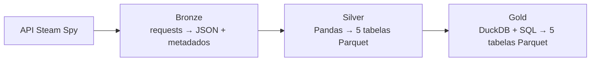

# Engenharia de Dados com arquitetura medalhão

Pipeline batch local que transforma dados de jogos do **Steam Spy** em tabelas analíticas, passando pelas camadas **Bronze, Silver e Gold**.

Criei este projeto para aprender, na prática, como organizar um fluxo de Engenharia de Dados: consumir uma API, preservar as coletas, tratar e modelar os dados e construir análises com SQL. Com foco de aprendizado a arquitetura medalhão. O domínio de jogos oferece perguntas concretas para esse aprendizado: quais jogos têm os maiores preços, quais desenvolvedores e publishers aparecem com mais títulos e como os jogos se distribuem por faixa de preço.

**Stack:** Python · requests · Pandas · PyArrow · DuckDB · SQL · Parquet · uv

**Estado atual:** as três camadas estão implementadas e conectadas por um script de execução. É um projeto de estudo com processamento local, execução manual 

## O que este projeto demonstra

| Competência praticada | Aplicação no projeto |
|---|---|
| Ingestão de dados | Consumo de API paginada, persistência por página e registro de sucessos e falhas. |
| Organização em camadas | Separação entre dados de origem, dados tratados e resultados analíticos. |
| Transformação com Pandas | Normalização de JSON, deduplicação, conversão de tipos e unidades, `explode` e `merge`. |
| Modelagem relacional | Separação de jogos, desenvolvedores e publishers, com tabelas de associação muitos-para-muitos. |
| SQL analítico | Junções, agregações, CTEs, classificação com `CASE` e rankings com funções de janela. |
| Persistência e reprocessamento | JSON na Bronze e Parquet na Silver e Gold; possibilidade de refazer as transformações sem consultar a API novamente. |
| Avaliação de limites | Identificação de problemas de parsing, rastreabilidade, estabilidade de IDs e qualidade de dados. |

## Arquitetura



O arquivo [`src/main.py`](src/main.py) executa as etapas sequencialmente: ingestão → Silver → Gold.

### Bronze — preservar a coleta

Implementada em [`src/ingest.py`](src/ingest.py).

- Consulta o endpoint `all` da API, com recorte fixo das páginas **0 a 9**.
- Aguarda 60 segundos antes de cada requisição a partir da segunda página.
- Salva cada resposta em um arquivo `page_<n>.json`, acrescentando `ingest_date` aos registros.
- Organiza as coletas em pastas com data e hora UTC.
- Grava um `metadata.json` com origem, início, fim e listas de páginas coletadas ou com falha.

Essa camada mantém os campos recebidos para permitir novas transformações sobre a mesma coleta. O JSON é desserializado e gravado novamente com metadados adicionais; não é uma cópia byte a byte da resposta HTTP.

### Silver — tratar e modelar

Implementada em [`src/silver.py`](src/silver.py).

A Silver seleciona a pasta de coleta mais recente pela data no nome. Antes de transformar os dados, exige a presença de metadados e páginas e interrompe o processamento se houver falhas registradas no manifesto. Se a coleta mais recente estiver incompleta, não procura automaticamente uma anterior.

As principais transformações são:

- Reunir os registros das páginas com `pd.json_normalize`.
- Remover duplicatas por `appid`, mantendo a primeira ocorrência, e renomear a chave para `app_id`.
- Converter preços de centavos para valores monetários e descontos para frações: `25` passa a ser `0.25`.
- Separar os nomes de desenvolvedores e publishers, com uma heurística para sufixos empresariais como `Inc.`, `Ltd.` e `LLC`.
- Criar entidades e associações com `explode`, `drop_duplicates` e `merge`.
- Persistir cinco tabelas em Parquet.

O código também converte `ingest_date` e separa os limites da faixa `owners` no DataFrame intermediário. Esses campos **ainda não são incluídos nas tabelas finais da Silver**.

### Gold — responder perguntas com SQL

Implementada em [`src/gold.py`](src/gold.py).

O DuckDB abre uma conexão em memória e registra cada Parquet da Silver como uma view. As consultas são exibidas no terminal e materializadas em `data/gold/`.

| Arquivo gerado | Pergunta respondida |
|---|---|
| `most_expensive_games.parquet` | Quais jogos têm o maior preço inicial? |
| `games_by_developer.parquet` | Quantos jogos estão associados a cada desenvolvedor e qual é o preço inicial médio desses títulos? |
| `games_by_publisher.parquet` | Quantos jogos estão associados a cada publisher e qual é o preço inicial médio desses títulos? |
| `games_by_price_range.parquet` | Como os jogos se distribuem por faixa de preço atual? |
| `games_by_ccu.parquet` | Quais jogos têm os maiores valores de `ccu` retornados pela fonte? |

Os rankings usam `RANK()`, permitindo empates, e são gravados por completo: não há um filtro de top 10 nas consultas. Em `games_by_price_range`, a coluna `percentage_games` contém uma proporção entre 0 e 1; por exemplo, `0.25` corresponde a 25%.

## Modelagem da Silver

Um jogo pode ter vários desenvolvedores e publishers. Por isso, essas relações são representadas por tabelas de associação, evitando restringir cada jogo a uma única empresa.

| Tabela | Granularidade pretendida | Colunas |
|---|---|---|
| `games` | Uma linha por jogo na coleta selecionada | `app_id`, `name`, `initial_price`, `price`, `discount`, `ccu` |
| `developer` | Uma linha por nome de desenvolvedor após o parsing | `developer_id`, `developer_name` |
| `publisher` | Uma linha por nome de publisher após o parsing | `publisher_id`, `publisher_name` |
| `game_developers` | Uma associação entre jogo e desenvolvedor | `app_id`, `developer_id` |
| `game_publisher` | Uma associação entre jogo e publisher | `app_id`, `publisher_id` |

As associações conectam `games.app_id` aos IDs de cada entidade. As chaves são lógicas: os arquivos Parquet não impõem restrições de chave primária ou estrangeira, e o pipeline ainda não valida integralmente essas relações nem deduplica os pares das associações.

Os IDs de desenvolvedores e publishers são sequenciais e recriados em cada processamento. Eles relacionam as tabelas daquela saída, mas não devem ser usados como identificadores estáveis entre coletas.

Como um jogo pode participar de várias associações, somar as contagens de todos os desenvolvedores ou publishers pode superar o total de jogos únicos.


## Como executar

Pré-requisitos: **Python 3.12**, **uv** instalado e acesso à internet para instalar dependências e consultar a API. O projeto fixa Python 3.12 em `.python-version` e declara suporte a `>=3.12` em `pyproject.toml`.

Na raiz do repositório, instale as dependências registradas no lockfile:

```bash
uv sync --locked
```

Execute o pipeline completo:

```bash
uv run python src/main.py
```

A coleta inclui nove pausas de 60 segundos: reserve **pelo menos cerca de nove minutos**, além do tempo das requisições e transformações. A implementação não configura timeout nas chamadas HTTP, então não há duração máxima garantida.

Também é possível executar cada etapa separadamente:

```bash
# Coletar novos dados
uv run python src/ingest.py

# Reprocessar a coleta mais recente disponível na Bronze
uv run python src/silver.py

# Recriar as análises a partir dos Parquets da Silver
uv run python src/gold.py
```

Para executar apenas Silver e Gold, os arquivos de entrada correspondentes precisam existir. A pasta `data/` é ignorada pelo Git e será preenchida pela execução local.

### Consultar uma saída

Após gerar a Gold, execute na raiz do repositório:

```bash
uv run python -c "import duckdb; duckdb.sql(\"SELECT name, ccu, rank FROM read_parquet('data/gold/games_by_ccu.parquet') ORDER BY rank, name LIMIT 10\").show()"
```

Esse exemplo seleciona dez linhas do ranking de `ccu`. As análises representam o recorte coletado, não todo o catálogo da Steam.

## Estrutura do repositório

```text
.
├── src/
│   ├── main.py            # Execução sequencial do pipeline
│   ├── ingest.py          # API → Bronze
│   ├── silver.py          # Bronze → tabelas relacionadas
│   └── gold.py            # Silver → análises SQL
├── data/                  # Gerada localmente; fora do Git
│   ├── bronze/
│   │   └── date_<timestamp UTC>/
│   │       ├── page_0.json ... page_9.json
│   │       └── metadata.json
│   ├── silver/            # Cinco tabelas Parquet
│   └── gold/              # Cinco resultados analíticos em Parquet
├── learn.md               # Anotações iniciais de estudo
├── normalizacao.png       # Material visual de modelagem
├── pyproject.toml         # Configuração e dependências
├── uv.lock                # Versões resolvidas das dependências
└── .python-version        # Versão de Python usada no projeto
```


